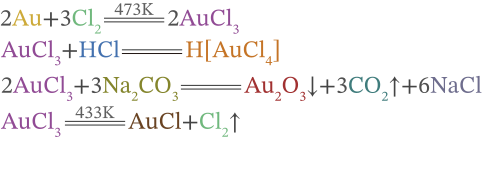

<picture>
  <source media="(prefers-color-scheme: dark)" srcset="./assets/AuCl3-dark.svg">
  
</picture>

<h2>谁是最专业的演员？微观粒子！

Who are the most professional actors? Microscopic particles!

### [🧪 化学开源项目总览 / Chemistry Open Source Projects Overview](./projects.md)
### [☢️ 经验之谈 / Experiences](./xp_CN.md)
### [⚠️ 氯家化学灾难喜剧集 / Chloride Family Chemistry Comedies](./Chloride_Family_Chemistry_Stories.md)
### [💛 支持我 / Support Me](./Donate.md)
---

### 关注方式 / Follow

开源环境需要大家共同维护。使用本仓库关联项目请遵守 CC BY-SA 4.0 协议。对于严重违反开源协议的行为，本人保留客观记录、公示相关情况的权利。
The open-source community needs our joint efforts to maintain. Please abide by the CC BY-SA 4.0 license when using projects associated with this repository. I reserve the right to objectively document and publicly disclose cases of serious license violations.
